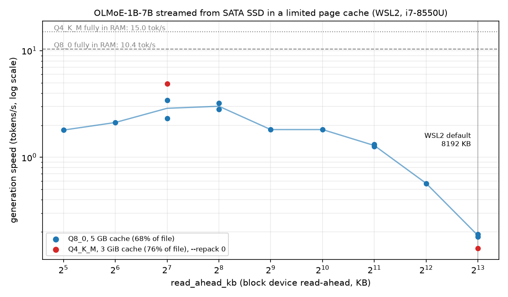

# cpu-inference-lab

Measuring what an LLM really needs to run on an ordinary, old laptop, and what actually helps.

One 2018 laptop (i7-8550U, 20 GB RAM, **SATA SSD**, WSL2) and one native-Linux EC2 instance (m6id.xlarge, 16 GiB, NVMe), four inference engines, one MoE model, every number reproducible from a script.

## TL;DR

**If you run a model that is bigger than your free RAM on WSL2, the default disk read-ahead (8 MB) makes it 17–35x slower than it needs to be.**
Setting `read_ahead_kb` to 128–256 KB took an MoE model streamed from SSD from **0.14–0.19 tok/s to 3–5 tok/s**, with no code change.

**Replicated on native Linux** (EC2 m6id.xlarge, kernel 6.17, ext4 on local NVMe, 3 reps per point): the same sweep gives the same shape.
Native Linux already defaults to 128 KB, so the penalty only bites when read-ahead is large (WSL2 ships 8192 KB; some RAID/LVM/tuned servers do too).



| Model (OLMoE-1B-7B) | Cache | read_ahead 8192 KB (WSL2 default) | read_ahead 128–256 KB |
|---|---|---|---|
| Q8_0 (7.4 GB) | 5 GB (68% of file) | 0.18–0.19 tok/s | 2.3–3.4 tok/s |
| Q4_K_M (4.2 GB), `--repack 0` | 3 GiB (76% of file) | 0.14 tok/s | 4.9 tok/s |
| fits in cache | any | 14.6–15.0 tok/s | 14.6–16.7 tok/s (no effect; one outlier at 10.4 with repack on, unexplained) |

**Native Linux, EC2 m6id.xlarge** (4 vCPU, 16 GiB, NVMe instance store; model streamed through a cgroup-limited cache, `--repack 0` for Q4):

| Model (OLMoE-1B-7B) | Cache | fully in RAM | read_ahead 8192 KB | 1024 KB | 256 KB | 128 KB (Linux default) |
|---|---|---|---|---|---|---|
| Q4_K_M (4.2 GB) | 3 GiB (76%) | 22.9 tok/s | 0.10 | 2.84 | 9.9 | **11.8** |
| Q8_0 (7.4 GB) | 5 GiB (68%) | 14.7 tok/s | 0.22 | 1.97 | 6.0 | **6.7** |

At the Linux default a model that does not fit still runs at ~45-51% of its in-RAM speed; at 8 MB read-ahead it is ~30-100x slower.
The 128 vs 256 KB difference is inside the run-to-run spread (3 reps, sd up to 4 tok/s). Hardware, disk speed and exact setup: `HARDWARE-ec2-m6id-xlarge.md`.
Raw log: `benchmarks/logs/ec2_m6id_xlarge_sweep.txt`.

A second trap, found on the way: **llama.cpp's default weight repacking copies Q4 weights into private RAM** (3.1 GB for a 4.2 GB file), so a
Q4 model cannot be streamed from disk and is OOM-killed under a memory limit. `--no-repack` (`llama-bench --repack 0`) fixes it; for this model it
cost no measurable speed (dense models not tested).

### Try it (WSL2, only matters when the model does not fit in RAM)

```bash
dev=$(df --output=source / | tail -1 | xargs basename); dev=${dev%%[0-9]*}   # e.g. sdd
cat /sys/block/$dev/queue/read_ahead_kb                                      # 8192 on WSL2
echo 128 | sudo tee /sys/block/$dev/queue/read_ahead_kb                      # resets on reboot; device name can change
llama-cli -m model.gguf --no-repack ...                                      # needed for Q4 types to stream
```

Not measured: effect on other workloads, persistence across reboots, other model families, the `--repack 1` OOM case on native Linux, SATA/HDD on native Linux, GPU offload.

Write-up: [On WSL2, a model bigger than your RAM runs ~35x slower than it should](https://abdufarag1.medium.com/on-wsl2-a-model-bigger-than-your-ram-runs-35x-slower-than-it-should-9243d1646599) (Medium).

## Four engines on the same laptop (CPU only, 4 threads)

| Engine | Model | Size | Prompt tok/s | Generation tok/s | Peak RAM |
|---|---|---|---|---|---|
| bitnet.cpp | BitNet-b1.58-2B-4T (i2_s) | 1.19 GB | 42.8 | **10.9** | 1.3 GB |
| PowerInfer (sparse) | ReluLLaMA-7B Q4_0 | 4.30 GB | 4.2 | 3.05 | 5.1 GB |
| llama.cpp | Qwen2.5-7B Q4_K_M | 4.68 GB | 8.2 | 2.99 | 7.5 GB |
| llama.cpp | Qwen2.5-7B Q8_0 | 8.10 GB | 5.7 | 1.83 | 7.7 GB |

- Generation speed sits at **85–100% of `RAM bandwidth / bytes read per token`** (14.8 GB/s here). Only reading fewer bytes makes it faster.
- **CPU activation sparsity (PowerInfer) gave no gain** on this machine.
- BitNet is fast because it is a small model; per parameter it is not faster than Q4. Its quality vs a 7B model is **not measured**.

## What did not work (kept on purpose)

- Predictor-driven expert prefetch: the disk is already at its sequential ceiling after the read-ahead fix; the oracle bound (~3x fewer misses) is not reachable by a real predictor. Parked with a written re-entry rule (`IDEAS.md`).
- ReLUfication, KV-cache-on-SSD: rejected at the benefit gate with reasons (`IDEAS.md`).
- Several of my own measurements were wrong at first (cold cache, a script bug, swap contamination); the flagged rows are still in `benchmarks/results.csv`.

## Limits of these results

One laptop (WSL2) plus one EC2 instance (native Linux; its NVMe measured only 430 MB/s sequential, far below a fast consumer NVMe), one MoE family, `llama-bench` generation from a near-empty context (real chat routes less repetitively; replayed real text gives a ~91% expert-cache hit rate at the 5 GB cache, so real speeds are somewhat lower), 16 tokens x 3-5 reps with the spread stored in `results.csv`. The raw disk speed on this laptop varied by up to 40% between runs. Projections for faster machines (`benchmarks/project_streaming.py`) are a model, not measurements.

**Status:** read-ahead result confirmed on WSL2 (lab laptop) and native Linux (EC2 m6id.xlarge, 2026-10-12). Docker image written but untested. Hostinger VPS was not used (it is a production box with 1 vCPU).

## Reproduce

```bash
git clone https://github.com/ahafarag/cpu_inferrence_lab.git cpu-inference-lab && cd cpu-inference-lab
sudo apt install build-essential cmake clang lld git curl python3 python3-venv util-linux
bash benchmarks/setup/run_all.sh --stages "env llamacpp moe"     # pinned engine commits, SHA256-verified models
sudo bash benchmarks/setup/50_moe_streamed.sh --model ~/models/moe/olmoe-1b-7b-0924-instruct-q4_k_m.gguf --cache-gb 3 --repack 0 --readahead "8192 128"
python3 benchmarks/compare.py
```

More: `benchmarks/setup/README.md` (stages, known traps), `MODELS.md` (every model URL and SHA256), `HARDWARE.md` (the machine),
`PLAN.md` / `IDEAS.md` (the decisions and why).

## License and disclaimer

Code, scripts and documentation in this repository are released under the MIT License (see `LICENSE`), **provided "as is", without warranty of any kind**.

- **Use at your own risk.** The benchmark scripts need root and change system settings (`read_ahead_kb`, `drop_caches`, cgroups), download multi-GB files and load the CPU and disk heavily. Do not run them on a machine that serves anything important. The author is not responsible for data loss, downtime, cost (for example cloud charges) or any other damage.
- **Results are measurements, not guarantees.** They describe the specific hardware, kernel and software versions listed in `HARDWARE*.md`. Your results may differ. The settings suggested here are not recommendations for any particular system.
- **Third-party software and models** (llama.cpp, bitnet.cpp, PowerInfer and the model files) are not included in this repository and keep their own licenses. Check each project's and model card's license before use; `MODELS.md` lists the sources.

## Repo map

- `benchmarks/` scripts and `results.csv` (the only source of numbers), `routing/` (expert-routing logger and cache replay)
- `MODELS.md`, `HARDWARE.md`, `RESEARCH_NOTES.md`, `PLAN.md`, `IDEAS.md`, `BENEFIT_GATE.md`
